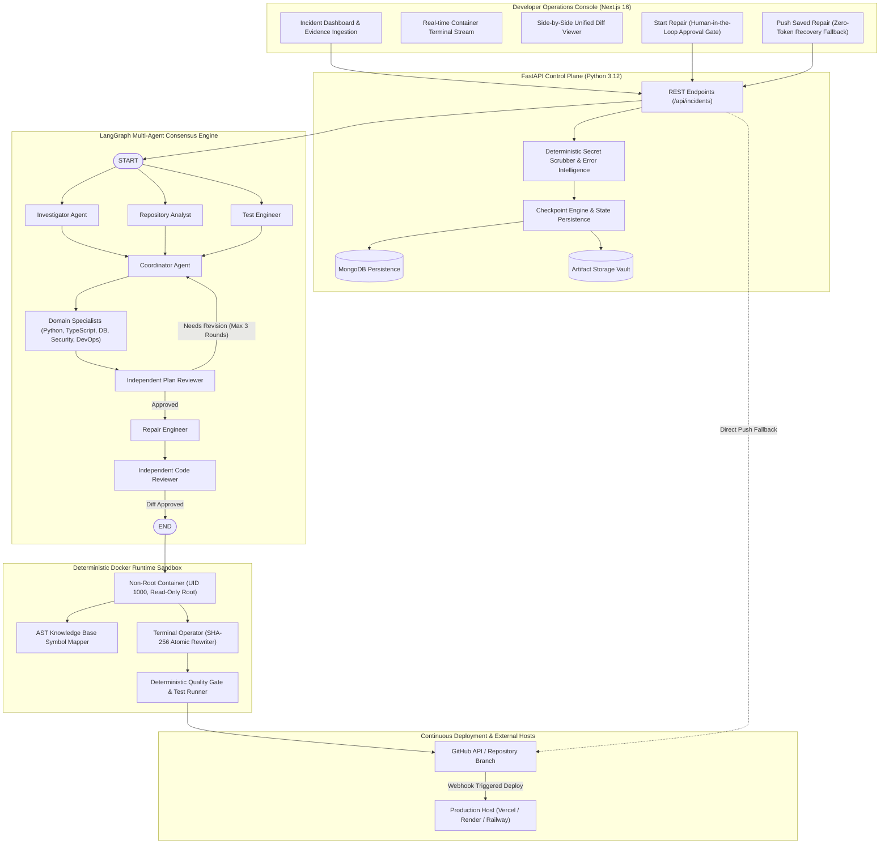
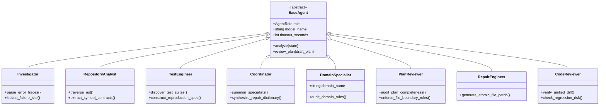
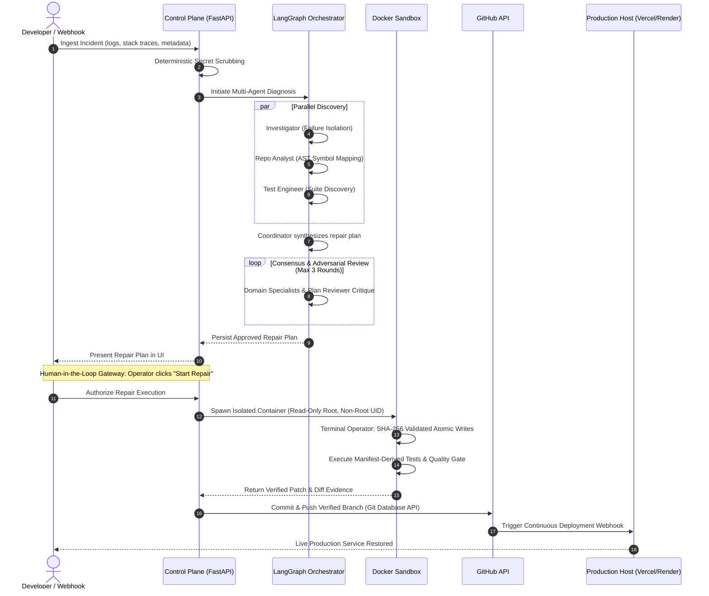
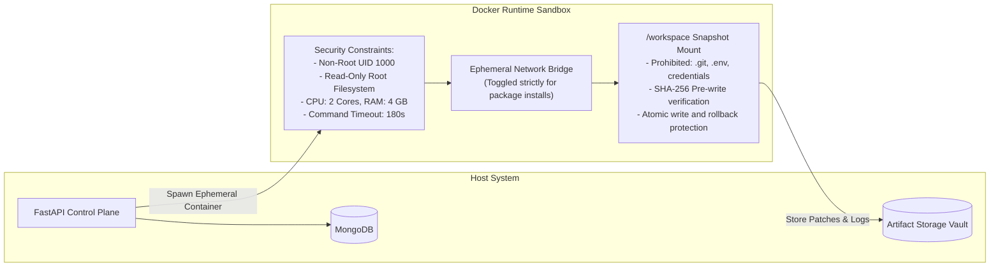
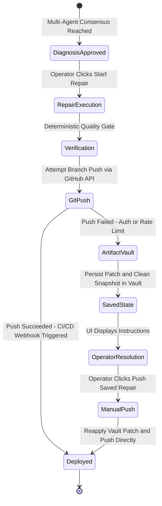

# VectoraFix: Autonomous Multi-Agent Incident Remediation Platform

> **Enterprise Multi-Agent AI System for Autonomous Incident Diagnosis, Sandboxed Code Repair, Verification, and Push-to-Deploy Delivery.**

---

## Executive Summary

**VectoraFix** is an enterprise-grade agentic platform engineered to autonomously diagnose, repair, verify, and remediate software failures across production and staging environments. The system derives its name from its foundational engineering mission: resolving both the **magnitude** (severity, scope, affected modules) and the **direction** (root-cause identification, minimal corrective patch, structural alignment) of software defects.

Built on a hybrid architecture of **multi-agent LLM reasoning** and **deterministic safety boundaries**, VectoraFix coordinates specialized engineering personas (implemented with LangGraph and LangChain, powered by Google Gemini) inside isolated Docker runtime sandboxes.

Rather than permitting unconstrained model execution, VectoraFix enforces strict human-in-the-loop gateways, immutable repository snapshots, full-diff scope verification, and fail-closed quality gates before pushing verified code to GitHub and updating live production deployments.

---

## Core Engineering Philosophy

```
+---------------------------------------------------------------------------------+
|                       VECTORAFIX CORE OPERATING PRINCIPLE                       |
|                                                                                 |
|  "Agentic reasoning is autonomous, but runtime execution and verification       |
|   are strictly deterministic."                                                  |
+---------------------------------------------------------------------------------+
```

Large Language Models (LLMs) excel at diagnostic deduction, cross-domain debate, and patch proposal. However, enterprise reliability mandates that code compilation, test execution, dependency isolation, and deployment synchronization remain governed by immutable, deterministic software boundaries:

1. **Untrusted Code and Input Isolation**: User logs, stack traces, and repository source code are treated strictly as untrusted data. Secrets and credentials are automatically scrubbed before persistence and model prompt injection.
2. **Container Sandboxing**: Code repairs, dependency installations, and test executions occur inside disposable, non-root Docker containers with read-only root filesystems and strict resource limits.
3. **Multi-Agent Consensus with Independent Code Review**: No single LLM prompt directly applies changes. A coordinator selects specialized domain engineers, forces iterative plan reviews, and mandates an independent code reviewer audit before any code modification is accepted.
4. **Human-in-the-Loop (HITL) Gateways**: Incident diagnosis generates a structured, human-readable repair plan. Source modification is strictly gated behind an explicit operator approval ("Start Repair").
5. **Continuous Deployment Synchronization**: Successful repairs are pushed directly to the repository branch (e.g., `main`), automatically triggering configured production build pipelines (such as Vercel, Render, or Railway).
6. **Fault-Tolerant Push Recovery**: If GitHub permissions, API rate limits, or network errors interrupt an automated push, the fully reviewed patch and workspace delta are preserved in an artifact vault. Operators can resolve permissions and trigger a direct push using the "Push Saved Repair" manual button without re-running model inference.

---

## System Architecture

The following diagram illustrates the four decoupled architectural tiers of VectoraFix: the Developer Operations Console, the FastAPI Control Plane, the LangGraph Multi-Agent Engine, and the Isolated Docker Sandbox.



---

## Agentic Maturity Assessment (Level 4 System)

VectoraFix is engineered in alignment with enterprise AI autonomy taxonomies:

| Level | Classification | Key Attributes | VectoraFix Implementation |
| :--- | :--- | :--- | :--- |
| **Level 1** | Simple Prompting / Direct Generation | Single-turn, stateless generation, no tool calling. | Atomic LLM leaf evaluations only. |
| **Level 2** | Chained Workflows & Routers | Fixed linear pipelines, prompt chaining, output parsing. | Sub-role LCEL prompt chains. |
| **Level 3** | Autonomous Tool-Using Agents | ReAct loops, dynamic tool calling, self-directed exploration. | `operate_isolated_terminal` inside Docker. |
| **Level 4** | **Collaborative Multi-Agent Systems** | **Dynamic role assignment, inter-agent debate, consensus loops, self-correction, DAG routing.** | **Core VectoraFix Architecture: Coordinated LangGraph team with specialized sub-agents and deterministic checkpoints.** |
| **Level 5** | Unconstrained Autonomous General Agents | Fully unbounded self-direction, open-ended goal generation. | Explicitly avoided. Enterprise production safety mandates deterministic boundaries. |

---

## Multi-Agent Team Composition

VectoraFix employs a directed acyclic graph (DAG) and cyclic review state machine managed by LangGraph. Specialized agent personas collaborate and debate before any code edit is authorized:



### Specialized Persona Responsibilities

- **Investigator**: Deconstructs raw stack traces, error messages, and operational symptoms to isolate the primary failure site.
- **Repository Analyst**: Traverses the AST symbol map to pinpoint target modules, parameter contracts, and dependency graphs.
- **Test Engineer**: Scans test frameworks (`pytest`, `jest`, `vitest`) to discover baseline tests and construct reproduction specifications.
- **Coordinator**: Evaluates preliminary findings, summons up to three domain specialists, and synthesizes the human-readable repair plan.
- **Domain Specialists (Python, TypeScript, Database, Security, DevOps)**:
  - *Python / TypeScript*: Verifies language idioms, type soundness, runtime compatibility, and syntax constraints.
  - *Database*: Audits schema migrations, ORM definitions, and query performance. Strictly prohibits destructive operations.
  - *Security*: Possesses absolute veto authority. Audits authorization boundaries, injection risks, and secret leakage.
  - *DevOps*: Audits package manifests, lockfiles, and container configurations.
- **Plan Reviewer**: Independent auditor acting as a quality gate before repair execution. Rejects ambiguous plans lacking exact file paths or concrete fixes.
- **Repair Engineer**: Generates minimal, scoped atomic file replacements strictly confined to approved targets.
- **Code Reviewer**: Independently audits the complete unified diff against original sources, blocking unapproved edits, binary changes, or style violations.
- **Verification Agent**: Evaluates test execution logs and health probe telemetry against baseline reproduction evidence.
- **Release Engineer**: Enforces final release readiness checklist before granting deployment clearance.

---

## End-to-End Remediation Lifecycle



---

## Deterministic Sandbox & Security Architecture



### Security Guardrails
1. **Deterministic Secret Scrubber**: Scans all ingested payloads with multi-pattern regular expressions, scrubbing bearer tokens, private keys, API keys, JWTs, and credential-bearing URLs prior to database persistence or LLM prompting.
2. **Read-Only Root Sandbox**: Containers run with `--read-only` root filesystems, restricting all write activity strictly to the `/workspace` mount.
3. **Non-Root Execution**: Container processes execute strictly as an unprivileged user (UID 1000).
4. **Network Gating**: The external network bridge is disabled by default and opened solely for detected package installation steps before being detached for test execution.
5. **Atomic SHA-256 Rewriting**: Source modifications verify target file checksums before performing atomic writes, rolling back to pre-repair snapshots if unexpected modifications occur.
6. **Strict Scope Control**: Any patch modifying files outside the coordinator's approved dictionary is rejected immediately by the deterministic quality gate.

---

## Fault-Tolerant Push Recovery ("Push Saved Repair")

When automated branch pushes fail due to GitHub App permission lapses, expired OAuth tokens, or branch protection rules, VectoraFix avoids wasting model inference or repeating diagnostic cycles:



---

## Repository Structure

```
VectoraFix/
├── README.md                                # Executive documentation & architecture overview
├── .gitignore                               # Production git ignore specification
│
├── docs/                                    # Exhaustive Architectural Specifications
│   ├── ARCHITECTURE.md                      # Comprehensive system architecture guide
│   ├── AGENT_ORCHESTRATION.md               # LangGraph DAG, cyclic review & agent specs
│   ├── RUNTIME_SANDBOX_AND_SECURITY.md      # Docker sandboxing, threat model & safety
│   ├── API_AND_DATA_CONTRACTS.md            # REST API schemas & persistence specs
│   └── RECRUITER_GUIDE.md                   # Technical breakdown for hiring managers
│
├── public_interfaces/                       # Non-Proprietary Interfaces & Public Contracts
│   ├── schemas/
│   │   ├── incidents.py                     # Pydantic v2 incident models & validators
│   │   └── agents.py                        # Multi-agent consensus & review models
│   └── contracts/
│       ├── base_agent.py                    # Abstract Base Agent contract interface
│       └── sandbox_interface.py             # Sandbox runtime & verification contract
│
└── config/                                  # Public Configuration & Packaging
    ├── .env.example                         # Environment configuration template
    └── pyproject.toml                       # Python packaging & tool definitions
```

---

## Recruiter & Codebase Access Information

> **Notice Regarding Proprietary Source Code**:  
> To protect proprietary intellectual property, algorithm implementations, LangGraph prompt graphs, and automated sandboxing runtimes from unauthorized cloning or distribution, core implementation source code is retained in a private repository.
>
> This showcase repository provides complete architectural documentation, system design specifications, and public contract interfaces demonstrating engineering standards, typing discipline, and system design maturity.

**Full access to the private source repository, end-to-end execution demonstrations, or architectural deep-dive interviews is available upon request.**

### Author & Contact Details

- **Author**: Dhruv Kajare
- **Email**: [kajaredhruv3@gmail.com](mailto:kajaredhruv3@gmail.com)
- **LinkedIn**: [https://www.linkedin.com/in/dhruv-kajare-b060b0260/](https://www.linkedin.com/in/dhruv-kajare-b060b0260/)
- **GitHub**: [@kajaredhruv433](https://github.com/kajaredhruv433)
- **Showcase Repository**: [https://github.com/kajaredhruv433/VectoraFix](https://github.com/kajaredhruv433/VectoraFix)
