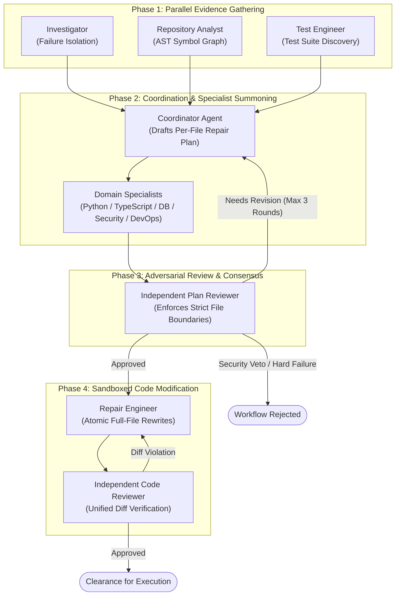
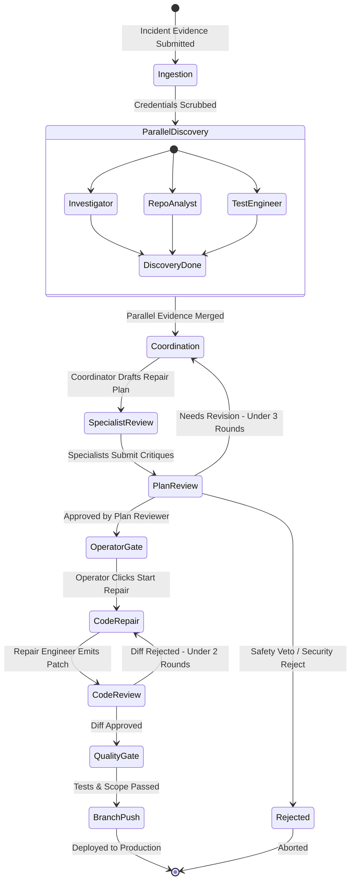
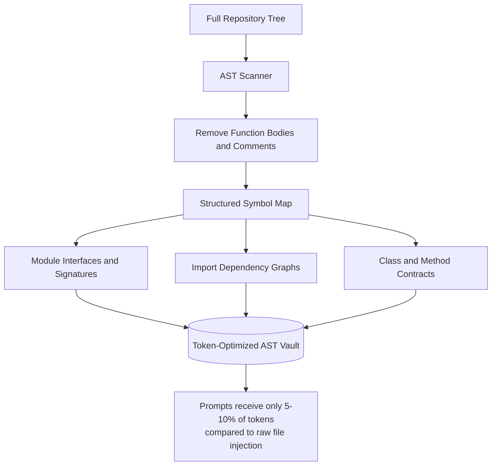

# VectoraFix: Multi-Agent Orchestration & Consensus Protocol

---

## 1. Overview & Agentic Taxonomy

VectoraFix implements a **Level 4 Collaborative Multi-Agent System** using LangGraph and LangChain, powered by Google Gemini. Rather than relying on a single monolithic prompt, VectoraFix divides the software remediation workflow into specialized, decoupled engineering personas that collaborate, critique, and reach consensus through bounded cyclical state transitions.

---

## 2. Multi-Agent Team Personas & Responsibilities

| Agent Persona | Role & Focus Area | Inputs | Verification Gate Authority |
| :--- | :--- | :--- | :--- |
| **Investigator** | Analyzes error messages, runtime stack traces, and failure logs. | Raw diagnostic evidence, error source tags, runtime environment metadata. | Determines whether sufficient reproduction evidence exists. |
| **Repository Analyst** | Analyzes project structure, AST symbols, imports, and dependencies. | Repository AST knowledge base, target commit SHA, project layout. | Pinpoints relevant files, function signatures, and parameter contracts. |
| **Test Engineer** | Discovers existing unit/integration tests and formulates reproduction plans. | Test suite files (`pytest`, `jest`, `vitest`), test manifests, CI logs. | Assesses baseline test coverage and designs verification assertions. |
| **Coordinator** | Synthesizes findings, summons domain specialists, and drafts per-file plans. | Diagnostic outputs from Investigator, Analyst, and Test Engineer. | Formulates the structured repair dictionary. |
| **Python Specialist** | Audits Python syntax, type hints, standard library idioms, and packaging. | Python source targets, AST chunks, runtime version (e.g., Python 3.12). | Flags language-specific antipatterns or version incompatibilities. |
| **TypeScript Specialist** | Audits TypeScript types, interface contracts, and module imports. | TS/JS source targets, `tsconfig.json`, module resolutions. | Validates type soundness and interface adherence. |
| **Database Specialist** | Audits ORM models, SQL queries, migration safety, and transactions. | Model definitions, migration scripts, database queries. | **Strictly prohibits destructive operations** or unindexed table scans. |
| **Security Specialist** | Audits auth tokens, secret leakage risks, input sanitization, and traversal. | Target files, environment configurations, authentication logic. | **Absolute Veto Power**. Any security violation halts the workflow immediately. |
| **DevOps Specialist** | Audits dependency additions, build scripts, container specs, and configs. | Package manifests (`package.json`, `requirements.txt`), lockfiles. | Blocks untrusted registries and unauthorized host mounts. |
| **Plan Reviewer** | Independent quality auditor cross-examining the complete plan. | Incident context, draft repair plan, all specialist critiques. | **Approval Gate**. Rejects plans lacking exact file paths or concrete fixes. |
| **Repair Engineer** | Generates minimal, scoped atomic file replacements for approved targets. | Approved repair dictionary, target source files, AST symbol contracts. | Confined strictly to files authorized by the Plan Reviewer. |
| **Code Reviewer** | Independently inspects the unified diff against the plan and policies. | Full workspace diff, approved repair dictionary, baseline source files. | **Diff Approval Gate**. Blocks unapproved files, binary changes, or secret additions. |
| **Verification Agent** | Evaluates post-patch test execution logs against baseline failure. | Baseline execution logs, post-patch test output, health probe telemetry. | Determines whether the incident is `resolved`, `not_resolved`, or `inconclusive`. |
| **Release Engineer** | Assesses release readiness and gate criteria before triggering Git push. | Verification metrics, quality gate results, audit checkpoints. | Grants final release clearance for GitHub push. |

---

## 3. Cyclical Consensus State Machine

To prevent infinite loops while allowing meaningful self-correction, VectoraFix enforces a **bounded cyclical state machine** capped at three consensus rounds:

### Convergence & Termination Guarantees
1. **Consensus Round Cap**: The cycle between `Coordinator` and `Plan Reviewer` is capped at exactly 3 iterations. If consensus is not reached by round 3, the plan transitions to operator escalation rather than looping indefinitely.
2. **Security Veto**: If the `Security Specialist` flags an unmitigated vulnerability (e.g., potential secret leakage, unescaped SQL, or unsafe deserialization), the plan is immediately marked `rejected` without further rounds.
3. **Deterministic Scope Enforcement**: The `Repair Engineer` cannot add new files to the repair dictionary. Any attempt to modify a file not explicitly authorized in the plan is blocked by the runtime.

---

## 4. Token Economics & AST Context Optimization

A common failure mode in multi-agent architectures is context dilution and excessive token consumption caused by dumping entire codebases into prompts. VectoraFix resolves this through **AST Symbol Extraction**:

- **90% Reduction in Token Ingestion**: Prompts include only function signatures, parameter types, return values, and module imports.
- **Elimination of Hallucinations**: Agents receive the exact symbol contracts validated by the parser, preventing fabricated method calls or parameter names.
- **Fast-Path Re-ranking**: When an error trace points to `app/services/auth.py:L84`, the orchestrator automatically loads the AST chunk for `app/services/auth.py` and its direct imports, discarding unrelated modules.

---

## Recruiter & Access Notice

The complete LangGraph state graph implementation, prompt templates, agent system prompts, and node handlers are retained in a private repository. For recruitment inquiries, technical interviews, or access to the private repository:

- **Author**: Dhruv Kajare
- **Email**: [kajaredhruv3@gmail.com](mailto:kajaredhruv3@gmail.com)
- **LinkedIn**: [https://www.linkedin.com/in/dhruv-kajare-b060b0260/](https://www.linkedin.com/in/dhruv-kajare-b060b0260/)
- **GitHub**: [@kajaredhruv433](https://github.com/kajaredhruv433)
