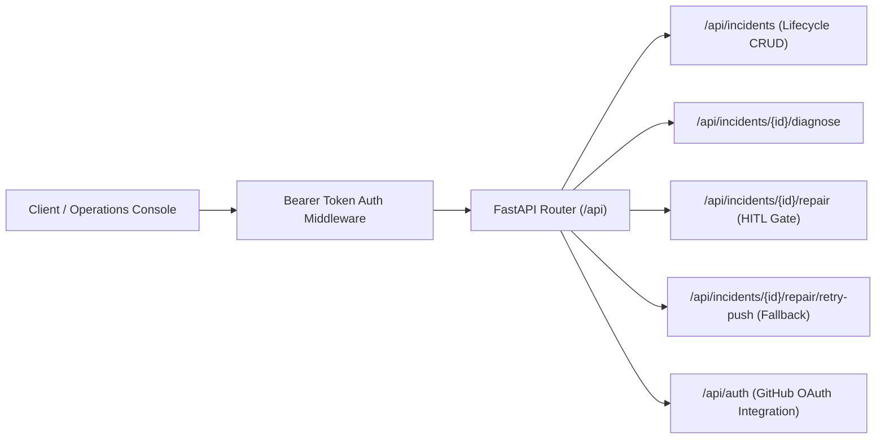
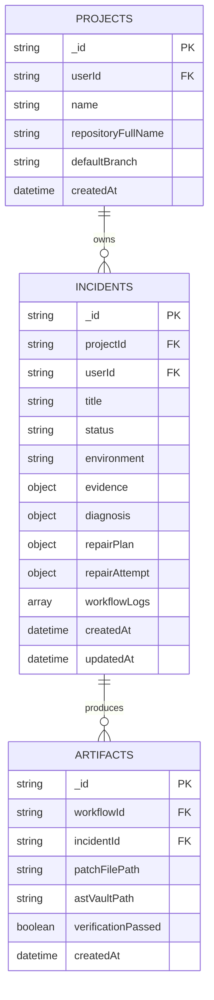

# VectoraFix: API Surface & Data Contract Specifications

---

## 1. REST API Architecture

The VectoraFix control plane exposes a strictly typed, authenticated REST API built with FastAPI and Pydantic v2.



---

## 2. Core REST Endpoints

### 2.1 Incident Management

#### `POST /api/incidents`
Creates a new incident record and triggers deterministic secret scrubbing.
- **Headers**: `Authorization: Bearer <token>`, `Idempotency-Key: <uuid>` (optional for deduplication).
- **Request Body**: `IncidentCreate` model.
- **Response**: `201 Created` with `IncidentResponse` schema.

```json
{
  "projectId": "proj_prod_ecommerce_backend",
  "environment": "production",
  "title": "Uncaught TypeError: Cannot read properties of undefined in order checkout",
  "errorSource": "backend_runtime",
  "errorMessage": "TypeError: Cannot read properties of undefined (reading 'taxRate')",
  "stackTrace": "TypeError: Cannot read properties of undefined\n    at calculateTaxes (/app/services/tax.ts:42:18)\n    at processCheckout (/app/services/checkout.ts:114:24)",
  "repositoryFullName": "kajaredhruv433/sample-service",
  "commitSha": "7f8b9a1e4c2d3f4a5b6c7d8e9f0a1b2c3d4e5f6a",
  "affectedUrl": "https://api.example.com/api/v1/checkout"
}
```

#### `GET /api/incidents/{id}`
Retrieves current incident status, sanitized diagnostic logs, and workflow phase.

#### `PATCH /api/incidents/{id}/evidence`
Appends additional logs, reproduction commands, or updated commit SHAs to an active incident.

---

### 2.2 Autonomous Diagnosis & Multi-Agent Coordination

#### `POST /api/incidents/{id}/diagnose`
Triggers the LangGraph multi-agent diagnostic DAG.
- **Workflow**:
  1. Synchronizes repository Git snapshot at `commitSha`.
  2. Constructs AST symbol knowledge base.
  3. Executes parallel discovery (`Investigator`, `Repository Analyst`, `Test Engineer`).
  4. Summons domain specialists and completes iterative review loop (up to 3 rounds).
  5. Stores the approved `RepairPlanSummary` in MongoDB.
- **Response**: `200 OK` returning structured diagnosis and repair strategy.

```json
{
  "incidentId": "inc_98234ab1",
  "status": "diagnosed",
  "rootCause": "calculateTaxes assumes countryConfig is always populated; missing null-coalescing guard when user checkout lacks ISO country code.",
  "hasDatabaseMigration": false,
  "confidenceScore": 0.94,
  "filesToModify": [
    {
      "path": "services/tax.ts",
      "defectDescription": "Missing null check on user countryConfig lookup prior to dereferencing taxRate.",
      "plannedFix": "Inject fallback default countryConfig and validate ISO code presence before calculation.",
      "riskLevel": "low"
    }
  ],
  "requiredTests": [
    "tests/unit/test_tax_calculator.ts"
  ],
  "operatorApproved": false
}
```

---

### 2.3 Sandboxed Repair & Push Delivery

#### `POST /api/incidents/{id}/repair` (Human-in-the-Loop Gateway)
Authorizes code modification inside the isolated Docker sandbox.
- **Requirement**: Incident must be in `diagnosed` status.
- **Security Check**: Gated strictly behind explicit operator authorization.
- **Workflow**:
  1. Boots ephemeral container.
  2. Applies approved modifications using the terminal operator.
  3. Runs baseline reproduction and regression test suite.
  4. Enforces the deterministic quality gate.
  5. Commits and pushes verified patch to GitHub via Git Database API.

#### `POST /api/incidents/{id}/repair/retry-push` (Zero-Token Recovery Fallback)
Allows direct re-pushing of an already verified patch without re-running model inference.
- **Use Case**: Used when GitHub token expiration or branch protection rules temporarily interrupted the automated push.
- **Behavior**: Retrieves pre-verified `.patch` from Artifact Storage Vault and pushes directly to GitHub. Consumes **0 LLM tokens**.

---

## 3. MongoDB Document Schemas



### Incident Document Structure
```json
{
  "_id": "673f8a9e2b1c4d0012a4e8f1",
  "projectId": "proj_prod_ecommerce_backend",
  "userId": "usr_gh_984124",
  "title": "Uncaught TypeError in order checkout",
  "status": "resolved",
  "environment": "production",
  "evidence": {
    "errorSource": "backend_runtime",
    "errorMessage": "TypeError: Cannot read properties of undefined",
    "stackTrace": "[REDACTED_TRACES]",
    "commitSha": "7f8b9a1e4c2d3f4a5b6c7d8e9f0a1b2c3d4e5f6a",
    "affectedUrl": "https://api.example.com/api/v1/checkout"
  },
  "diagnosis": {
    "rootCause": "Null dereference in tax calculator.",
    "confidenceScore": 0.94,
    "completedRounds": 2
  },
  "repairPlan": {
    "filesToModify": [
      {
        "path": "services/tax.ts",
        "defectDescription": "Missing null check on countryConfig",
        "riskLevel": "low"
      }
    ],
    "operatorApproved": true
  },
  "repairAttempt": {
    "attemptNumber": 1,
    "status": "verified",
    "githubPush": "success",
    "pushedBranch": "main",
    "commitSha": "8a9b0c1d2e3f4a5b6c7d8e9f0a1b2c3d4e5f6a7b"
  }
}
```

---

## Recruiter & Access Notice

Proprietary endpoint implementations, FastAPI router handlers, MongoDB aggregation pipelines, and OAuth encryption routines are maintained in a private repository. For recruitment inquiries or full access:

- **Author**: Dhruv Kajare
- **Email**: [kajaredhruv3@gmail.com](mailto:kajaredhruv3@gmail.com)
- **LinkedIn**: [https://www.linkedin.com/in/dhruv-kajare-b060b0260/](https://www.linkedin.com/in/dhruv-kajare-b060b0260/)
- **GitHub**: [@kajaredhruv433](https://github.com/kajaredhruv433)
