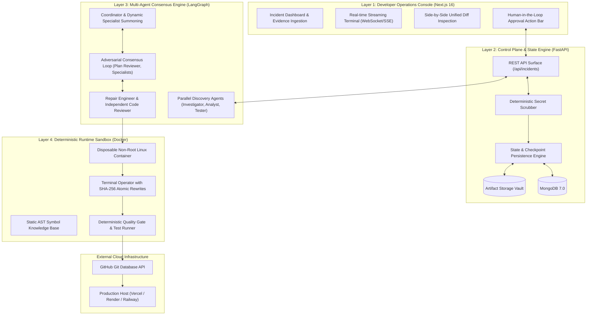
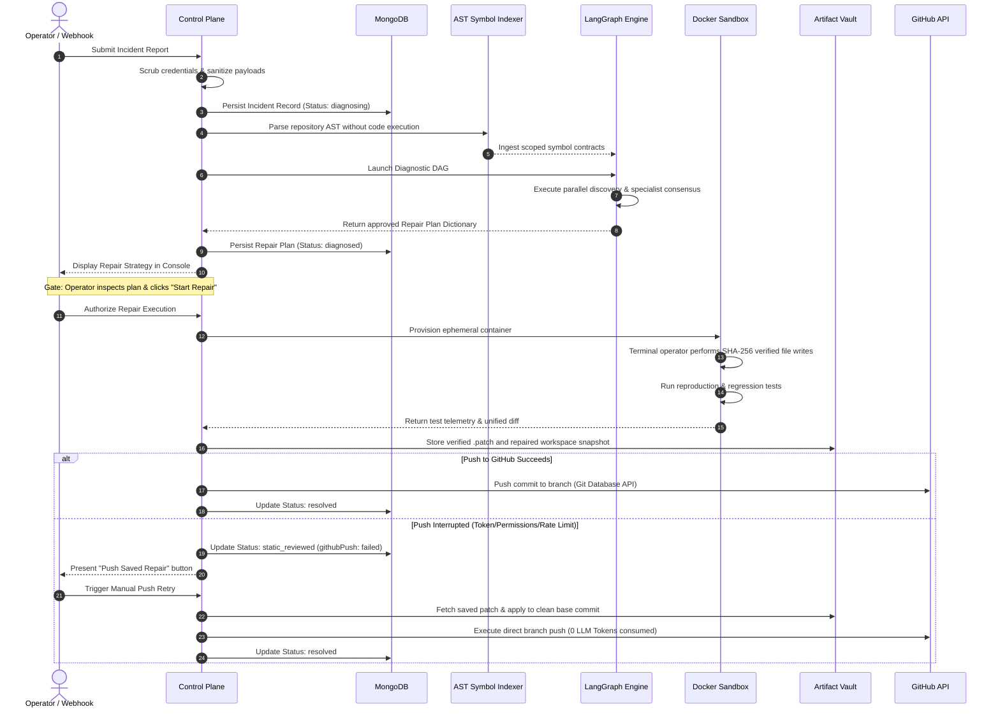
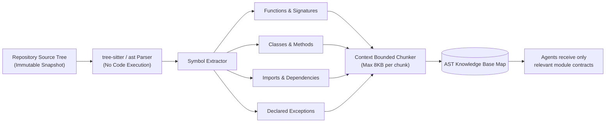

# VectoraFix: Comprehensive System Architecture Specification

---

## 1. System Overview & Core Philosophy

VectoraFix is an autonomous production incident diagnosis, code repair, verification, and deployment platform. Its name reflects its foundational mission: resolving both the **magnitude** (severity, scale, dependencies) and the **direction** (root cause, corrective patch, architectural alignment) of software failures.

The system is built on a fundamental design principle:

> **Agentic reasoning is autonomous, but runtime execution and verification are strictly deterministic.**

Large Language Models (LLMs) operate as intelligent reasoners capable of diagnosis, cross-domain debate, and patch proposal. However, untrusted code execution, dependency management, Git operations, and production deployment safety are governed by immutable, deterministic software boundaries:

1. **Untrusted Code and Input Isolation**: User logs, stack traces, and repository source code are treated strictly as untrusted data. Secrets and credentials are automatically scrubbed before persistence and model prompt injection.
2. **Container Sandboxing**: Code repairs, dependency installations, and test executions occur inside disposable, non-root Docker containers with read-only root filesystems and strict resource limits.
3. **Multi-Agent Consensus with Independent Code Review**: No single LLM prompt directly applies changes. A coordinator selects specialized domain engineers, forces iterative plan reviews, and mandates an independent code reviewer audit before any code modification is accepted.
4. **Human-in-the-Loop (HITL) Gateways**: Incident diagnosis generates a structured, human-readable repair plan. Source modification is strictly gated behind an explicit operator approval ("Start Repair").
5. **Continuous Deployment Synchronization**: Successful repairs are pushed directly to the repository branch (e.g., `main`), automatically triggering configured production build pipelines (such as Vercel, Render, or Railway).
6. **Fault-Tolerant Push Recovery**: If GitHub permissions, API rate limits, or network errors interrupt an automated push, the fully reviewed patch and workspace delta are preserved in an artifact vault. Operators can resolve permissions and trigger a direct push using the "Push Saved Repair" manual button without re-running model inference.

---

## 2. Decoupled Architectural Layers

VectoraFix is architected across four decoupled layers:



### Layer 1: Developer Operations Console
- **Framework**: Next.js 16, React 19, TypeScript.
- **Role**: Provides the human-in-the-loop interface. Streams real-time diagnostic logs, renders the synthesized file repair plan, offers an interactive side-by-side diff viewer, and exposes the manual "Start Repair" and "Push Saved Repair" control buttons.

### Layer 2: FastAPI Control Plane
- **Framework**: FastAPI (Python 3.12), Pydantic v2, Motor (async MongoDB driver).
- **Role**: Validates payloads, strips sensitive authentication tokens via regex secret scrubbing, maintains state transitions in MongoDB, orchestrates background workflow tasks, and manages OAuth tokens.

### Layer 3: LangGraph Multi-Agent Orchestration
- **Framework**: LangGraph, LangChain, Google Gemini (`gemini-2.5-pro` / `gemini-3.1-flash-lite`).
- **Role**: Coordinates parallel evidence gathering, dynamic specialist invocation, iterative adversarial critique, and code generation. Enforces maximum iteration bounds (capped at 3 rounds) to guarantee convergence.

### Layer 4: Deterministic Docker Runtime Sandbox
- **Engine**: Docker Engine via Python Docker SDK.
- **Role**: Provides isolated Linux environments with non-root UID 1000, read-only root filesystems, CPU and RAM constraints, and gated network access. Hosts the AST symbol extractor, terminal operator, and test verification suite.

---

## 3. High-Level Data Flow



---

## 4. Abstract Syntax Tree (AST) Knowledge Base

One of VectoraFix's core innovations is eliminating token bloat and hallucination by parsing the repository into an Abstract Syntax Tree (AST) without executing untrusted code:



### Key Advantages
- **Security**: The target repository is never executed during indexing, preventing malicious repo payloads from compromising the host.
- **Context Economy**: Instead of injecting thousands of lines of raw source code into prompts, agents receive only the exact function contracts, parameter types, and import relationships relevant to the stack trace.
- **Deterministic Correlation**: Stack trace line numbers and module paths are mapped with 100% accuracy to the AST symbol graph.

---

## 5. Fault-Tolerant Push Recovery & Artifact Vault

Automated CI/CD pipelines frequently experience transient infrastructure failures such as GitHub API rate limits, temporary permission lapses, or branch protection rule updates. Traditional AI tools fail completely when this occurs, forcing operators to restart from scratch.

VectoraFix solves this with an **Artifact Vault & Manual Fallback Architecture**:

```
artifacts/{workflowId}/
├── knowledge-base/
│   ├── symbol-map.json
│   └── context-chunks.json
├── file-repair-dictionary.json
├── repair-attempt-1.patch
└── repaired-workspace/
```

- When a verification pass succeeds, the unified diff (`.patch`) and clean repaired workspace are persisted to disk.
- If the automated push fails, the workflow status transitions to `static_reviewed` or `verified_local` with `githubPush: "failed"`.
- The operator resolves the GitHub App configuration or token permission.
- The operator clicks **"Push saved repair to GitHub"** (`POST /api/incidents/{id}/repair/retry-push`).
- The backend reads the saved patch from the vault, reapplies it to the clean base commit, and completes the push directly.
- **Gemini is not re-invoked, diagnosis is not repeated, and no additional tokens are consumed.**

---

## 6. Enterprise Security Summary

| Vector | Threat | VectoraFix Defense Mechanism |
| :--- | :--- | :--- |
| **Input Data** | Ingestion of production API keys or tokens in logs | Multi-pattern regex secret scrubber redacts credentials prior to persistence or model submission. |
| **Untrusted Code** | Malicious repo code executing arbitrary commands | Non-root execution (UID 1000), read-only root filesystem, isolated disposable container mounts. |
| **Prompt Injection** | Adversarial comments or logs attempting to override agent instructions | Untrusted code and logs are strictly encapsulated inside JSON structures and flagged with system-level instruction boundaries. |
| **Scope Creep** | Model inadvertently modifying configuration, `.env`, or unrelated files | File allowlists strictly derived from the approved repair dictionary; deterministic quality gate rejects out-of-scope diffs. |
| **Filesystem Safety** | Path traversal attacks (`../../etc/passwd`) | Strict path normalization and allowlist checks prevent writes outside the container's disposable workspace. |

---

## Recruiter & Access Notice

Proprietary source code, LangGraph graph compilation definitions, and container sandboxing implementations are retained in a private repository. Full access to the private repository and live system demonstrations is available upon contacting the author:

- **Author**: Dhruv Kajare
- **Email**: [kajaredhruv3@gmail.com](mailto:kajaredhruv3@gmail.com)
- **LinkedIn**: [https://www.linkedin.com/in/dhruv-kajare-b060b0260/](https://www.linkedin.com/in/dhruv-kajare-b060b0260/)
- **GitHub**: [@kajaredhruv433](https://github.com/kajaredhruv433)
