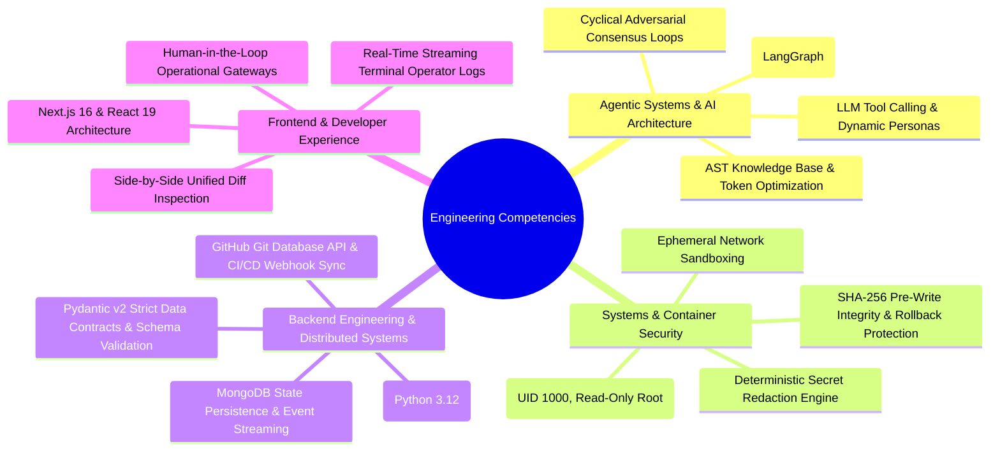

# VectoraFix: Technical Recruiter & Engineering Hiring Guide

> **A technical breakdown of engineering capabilities, system design decisions, and architectural innovations demonstrated in VectoraFix.**

---

## 1. Candidate Profile & Demonstrated Core Competencies

VectoraFix was designed and engineered from the ground up by **Dhruv Kajare** to solve critical reliability challenges in production AI systems. The project demonstrates senior-to-staff level engineering capabilities across multiple disciplines:

---

## 2. Key Architectural Innovations

### 1. Level 4 Autonomous Multi-Agent Consensus
- **Problem**: Monolithic LLM prompts often hallucinate, miss subtle regressions, or propose changes that break secondary systems.
- **Solution**: VectoraFix structures remediation into a collaborative LangGraph state machine. Specialized personas (`Investigator`, `Repository Analyst`, `Test Engineer`, `Coordinator`, domain specialists, and independent reviewers) debate and refine repair strategies across bounded cyclical review rounds.

### 2. AST Symbol Knowledge Base (90% Token Reduction)
- **Problem**: Injecting entire repositories into LLM contexts wastes thousands of tokens and causes model context dilution. Executing repository code to introspect structure is an extreme security risk.
- **Solution**: Built a static AST parser that extracts function signatures, parameter contracts, return types, and import graphs without ever executing target repository code. Bounded chunks provide the model with exact contracts, reducing context overhead by up to 90%.

### 3. "Agentic Reasoning, Deterministic Execution" Design Pattern
- **Problem**: Granting LLMs unbounded execution rights or relying on single prompt code generation leads to unsafe file modifications and production outages.
- **Solution**: LLMs operate as pure reasoning engines. File modifications, dependency installations, and test runs are forced through an isolated Docker container with non-root UID, read-only root filesystems, SHA-256 checksum pre-conditions, and deterministic quality gates.

### 4. Zero-Token Push Recovery ("Push Saved Repair")
- **Problem**: Automated Git pushes to GitHub frequently fail due to expired OAuth tokens, GitHub App installation permission updates, or rate limits. Traditional agents abort and require re-running inference from the start.
- **Solution**: VectoraFix automatically persists verified patches and workspace snapshots into an Artifact Vault. Operators can re-authorize GitHub and deploy the verified fix with a single click without re-invoking Google Gemini, consuming **zero additional LLM tokens**.

---

## 3. Technology Stack Reference

| Tier | Technologies Employed |
| :--- | :--- |
| **Agentic Framework** | LangGraph, LangChain, Google Gemini (`gemini-2.5-pro`, `gemini-3.1-flash-lite`) |
| **Backend Control Plane** | Python 3.12, FastAPI, Pydantic v2, Motor (Async MongoDB), Uvicorn |
| **Frontend Console** | Next.js 16, React 19, TypeScript, Vanilla CSS design tokens |
| **Runtime & Sandboxing** | Docker Engine SDK, Linux container hardening, Non-root UID, tmpfs |
| **Data & Storage** | MongoDB 7.0, Local Artifact Vault, JSONL Checkpoints |
| **Static Code Analysis** | Tree-Sitter, Python AST standard library |
| **Integrations** | GitHub Git Database API, OAuth 2.0 PKCE, Vercel / Render CI/CD webhooks |

---

## 4. Requesting Full Codebase Access & Walkthrough

> **Proprietary Source Code Policy**:  
> To protect core agent graph logic, custom sandbox runtime scripts, and intellectual property from unauthorized cloning or distribution, full source code is maintained in an authenticated private repository.

### For Technical Recruiters & Hiring Managers:
Dhruv welcomes in-depth code reviews, system design discussions, and live demonstration sessions for qualified engineering opportunities.

To request:
- An invitation to the private source repository
- An end-to-end live demonstration of autonomous incident remediation
- A technical architectural interview

### Contact Dhruv Kajare:
- **Author**: Dhruv Kajare
- **Email**: [kajaredhruv3@gmail.com](mailto:kajaredhruv3@gmail.com)
- **LinkedIn**: [https://www.linkedin.com/in/dhruv-kajare-b060b0260/](https://www.linkedin.com/in/dhruv-kajare-b060b0260/)
- **GitHub**: [@kajaredhruv433](https://github.com/kajaredhruv433)
- **Showcase Repository**: [https://github.com/kajaredhruv433/VectoraFix](https://github.com/kajaredhruv433/VectoraFix)
